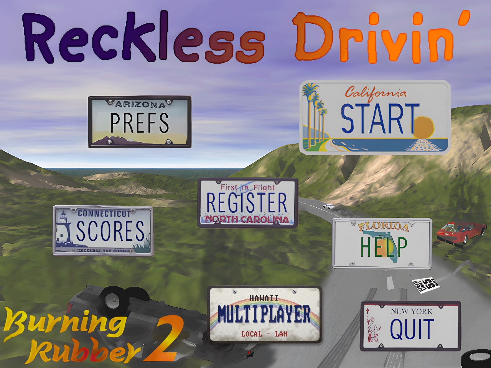
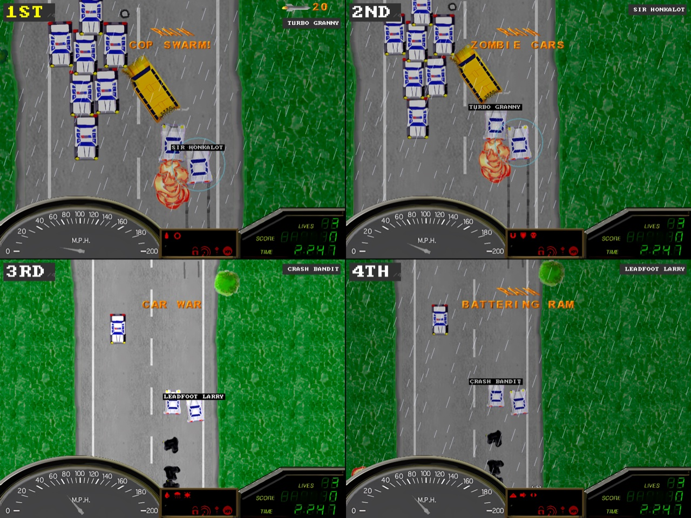
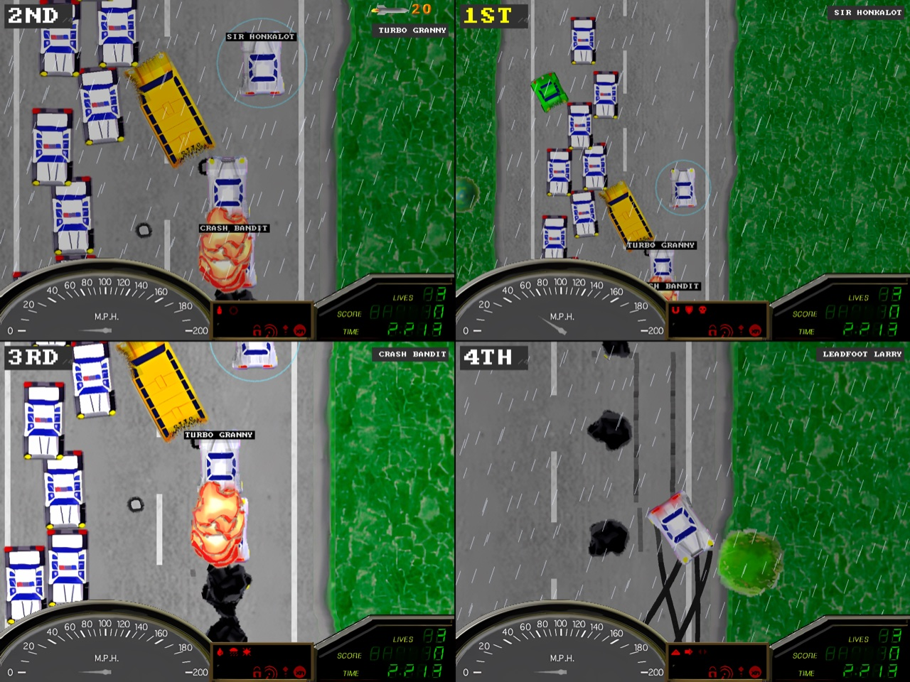

<div align="center">


# Reckless Drivin' – Multiplayer Edition

[](https://github.com/DarrCoh/reckless-drivin-sdl/actions/workflows/build.yml)
[](https://github.com/DarrCoh/reckless-drivin-sdl/actions/workflows/build.yml)
[](https://github.com/DarrCoh/reckless-drivin-sdl/actions/workflows/build.yml)

### A native SDL2 port of the classic Mac OS racing game, for up to ten drivers

*Originally by [Jonas Echterhoff](https://github.com/jechter/RecklessDrivin) (2000), brought back to life on modern hardware*

**macOS (Apple Silicon & Intel) &bull; Windows &bull; Linux &bull; SDL2 &bull; No Emulator Required**

---



*640x480 software-rendered, pixel-perfect; just like it was in 2000*


*Multiplayer Edition: four drivers in split screen, up to ten on a LAN*

</div>

> **About this README:** most of it comes from the
> [SDL2 port](https://github.com/DarrCoh/reckless-drivin-sdl) by Darren Cohen,
> including *The Story* below and the technical sections. The parts marked
> *Multiplayer Edition* were added by Cengineering.

---

## The Story

*By Darren Cohen, who made the SDL2 port this edition is built on.*

Reckless Drivin' was one of *those* games. The kind that came pre-installed (or maybe my brothers found it on some shareware CD) on our family Mac back in the day. My brothers and I played it for hours, weaving through traffic, smashing into things, trying to beat each other's times.

Years later, I got hit with a tiny wave of nostalgia. I wanted to play it again, for old time's sake. Not in an emulator, not through some janky compatibility layer, but **running natively on my MacBook**.

The original source code had been [released on GitHub](https://github.com/jechter/RecklessDrivin) by Jonas Echterhoff in 2019 under the MIT license. How hard could it be, you'd say? Turns out: *very*. The original code was pure Classic Mac OS: PowerPC, big-endian, 32-bit, built with CodeWarrior, using DrawSprocket, InputSprocket, the Mac Sound Manager, and Mac Resource Forks. None of that exists anymore. Every platform API had to be replaced. Every byte of game data was stored backwards relative to my CPU. It was a rabbit hole, and I went all the way down.

This is the result: a port of Reckless Drivin' with all 10 levels, every screen, and every effect, running natively with pixel-perfect graphics, proper audio, and full mouse + keyboard + gamepad controls.

---

## Why a Multiplayer Edition

*By Cengineering, Multiplayer Edition (2026).*

I played Reckless Drivin' with my brother, too. He found it on the CD-ROM of a computer magazine, and we were hooked long before the shareware levels ran out. To register it, we went to the bank together to change our money, put the cash in an envelope and mailed it to Jonas Echterhoff. Then we waited. I still remember the day the letter with the registration code arrived; it is one of those small moments that stayed with me, just like all the hours we spent racing, crashing and laughing in front of that screen with my siblings.

As a kid I always wondered how the game actually worked: why the cops knew where to find you, how the traffic decided when to brake, what was inside those add-on packages. With the source code open, I finally got to look under the hood, and changing and extending those mechanics for multiplayer turned out to be just as much fun as playing it back then.

The original only ever let one of us drive at a time, while the others watched and waited for their turn. I made the multiplayer mode so that my siblings and I can play it together again, each in our own car, and relive a piece of our childhood side by side. This edition is my thank-you to that game and to those afternoons, and maybe it brings other brothers and sisters, friends and kids together in front of the screen as well.

None of this would exist without the people who brought the game back. Thank you, Jonas Echterhoff, for making it and for releasing the source; thank you, Darren Cohen, for porting it to today's computers, and Nate Craddock for the reverse engineering that made that possible. Being able to start Reckless Drivin' again on a modern Mac is getting a piece of my childhood back.

---

## Features

- **All 10 levels fully playable:** including the encrypted shareware levels, properly decrypted with the [free registration key](http://jonasechterhoff.com/Reckless_Drivin.html)
- **24 driveable vehicles:** sports cars, muscle cars, motorcycles, semi trucks, a tank, a helicopter, police interceptors, boats, and more; selectable via the cheat mode level select and multiplayer vehicle selection
- **Pixel-perfect rendering:** 640x480, software-rendered into a 32-bit framebuffer and uploaded via SDL2 streaming texture; the original 16-bit art looks as it did, HQ assets keep their full color
- **Full audio:** 18-channel software mixer at 44.1 kHz stereo, with Doppler effect and 3D positional sound
- **Every screen implemented:** main menu, help, high scores, preferences, pause, game over, and scrolling credits
- **High score table:** top 10 scores rendered on-screen with keyboard name entry
- **Screen transitions:** fade to/from black, venetian-blind shift-in effect, game over animation
- **Menu polish:** hover highlights and press states on all buttons, click sound feedback
- **Remappable controls:** rebind all 8 game keys from the Preferences menu
- **Gamepad support:** SDL2 GameController API with analog stick + triggers
- **Multiplayer:** up to four drivers on one computer (split screen) or up to ten over a local network
- **Per-player controls:** configure Solo and all four local/network driver key profiles from Preferences or by pressing P in the multiplayer menu
- **Resizable window:** maintains 4:3 aspect ratio with letterboxing
- **Optional 2x upscaling:** smooth 1280x960 display output, selectable in Preferences
- **Optional AI rendering:** toggle enhanced sprites, textures, HUD, and menus on/off in Preferences; OFF uses the original game graphics
- **Persistent preferences:** settings, high scores, lap records, and key bindings saved between sessions
- **Native macOS app bundle:** builds as a proper `.app` with SDL2 bundled inside; distribute as a DMG or zip it and send to a friend
- **Broad compatibility:** macOS 11.0+ (Big Sur through current), Windows 10/11 (x64), Linux (x86_64, ARM64)
- **No external dependencies on macOS:** SDL2 is bundled into the app automatically; no Homebrew or manual installs needed to run

---

## Multiplayer Edition

*Added by Cengineering.* This fork turns the port into a party game: up to four drivers race each
other on one computer (split screen), up to ten across a local network, with game
modes, new crates and wilder traffic on top of the original game. Single
player stays as it was; the original traffic and add-ons are one setting away
(**Game Mode: ORIGINAL** in Preferences).

<p align="center">
  
  
  <br>
  <em>Turbo Granny, Sir Honkalot, Crash Bandit and Leadfoot Larry on level 1: one crate each, then chaos</em>
</p>

### What's new

- **Local and LAN multiplayer:** up to four drivers in split screen on one
  computer, up to ten on a LAN (own screen each from five drivers on), each
  with their own car, controls, lives, score and finish result
- **Driver names:** type your name in the LAN lobby (**N**); the others see it
  in their lobby and over your car during the race
- **Bigger add-on display (Extended mode):** the cockpit's red add-on display
  grows by a row; the timed crates show there as red pictures like the
  original add-ons, blinking when they run out
- **Cops stay in the game:** a driver the police pushed off the road comes
  back with a moment of shield; the cops drive on instead of vanishing
- **Start level:** choose the level a multiplayer game starts in (**LEVEL**
  button or **+/-** in the multiplayer menu); on a LAN the host's choice counts
- **Own sound for every driver:** in split screen each driver has their own
  engine and skid sounds, coming from their side of the screen, and sounds in
  the world are heard from the closest driver; on a LAN every computer plays
  its own driver
- **LAN host search:** joining lists the hosts on the network, no IP typing
- **One shared world:** the host simulates traffic, cops and pickups, so every
  computer sees the same cars, dents, skid marks, explosions and packages
- **Common start:** cars wait until every computer has loaded the level, then
  3, 2, 1, GO; the host runs the race clock for everyone
- **Six game modes** and **21 kinds of crates**, each with an adjustable
  frequency, plus **11 crate themes**
- **Extended traffic:** overtaking, jams, panic and road rage after crashes,
  police that hunt whoever rams them
- **AI-upscaled HQ graphics** for sprites, roads, HUD, menus and font
  (on by default, compressed to about 85 MB)

### Original or AI-upscaled graphics

Out of the box the game starts with an AI-upscaled variant of every sprite,
road texture, HUD element, menu picture and the font, included in this
repository; it runs fullscreen at twice the original resolution (**HQ 4K
Mode**). Whoever wants to enjoy the game the way it looked in 2000 can do
just that: open **Preferences** and turn **AI Rendering** off for the
original pixel graphics (and **HQ 4K Mode** off for a window). Turning **AI
Rendering** on again brings the upscaled graphics back at any time. Builds
without the `AIAssets/` folder simply show the original graphics.

### LAN in six steps

1. Start the game on every computer (same version on all of them).
2. On one computer choose **MULTIPLAYER**, pick a mode with **M** or the
   arrows, set the crates with **K**, then **HOST LAN GAME**.
3. On the others choose **MULTIPLAYER** and **JOIN LAN GAME**; the host
   appears in the list.
4. Everyone picks a car in the lobby, types a name with **N** (and **V** for
   split or own screen).
5. The host starts; the race begins on all computers with a countdown.
6. After the game: the host hosts the same game again and the others rejoin
   it by themselves, so everyone is back in the lobby (a local game returns
   to the multiplayer menu). A typed host address is remembered.

### Game modes

| Mode | What happens |
|---|---|
| **Co-op** | Hits cost a life but score nothing; finished drivers can give a life to a driver who is out |
| **Duel** | Missiles and mines hit rivals too; every takedown scores 1000 points |
| **Packages** | Packages all over the road; a cop swarm hunts the driver who found it, with at least 20 cops |
| **Police** | Two more cops every 2.5 seconds, and they ram |
| **Zombie** | Every ordinary car near a driver turns and hunts him |
| **Wildlife** | Animals cross the road everywhere, and new ones keep coming out ahead of every driver |

### Crates

Add-on packages can contain any of these (the timed ones last 15 seconds):

| Crate | Effect |
|---|---|
| Addon Lock, Mines, Missiles, Spikes, Police Jammer, Turbo, 2000 Points, Extra Life | The original eight add-ons |
| Super Grip | 1.8 times the road grip |
| Offroad Tyres | Leaving the road is no crash |
| Magnet | Packages close by fly to the car |
| Shield | The next crash costs no life |
| Battering Ram | Rammed cars fly off and explode |
| Oil Slick | Oil behind the car sends followers spinning |
| Nitro | Two and a half times the engine power, with flames |
| Rain Maker | Rain and much less grip for everyone else |
| Zombie Cars | Traffic hunts the other drivers (alone: you) |
| Car War | Traffic rams each other into the ditch |
| Clear Road | Traffic makes way early, without leaving its carriageway |
| Cop Swarm | A pack of police cars hunts the race leader |
| Traffic Jam | A wall of slow cars ahead of the race leader |

In the **CRATES** screen (**K**) every crate gets **OFF**, **RARE**, **NORMAL**
or **OFTEN**, and the number of packages on the road is **FEW** to **MANY**.

### Crate themes

Instead of one mix, a theme can decide, either the same every level or a
random one per level (announced at the start):

| Theme | Mostly |
|---|---|
| Weapons | Mines, missiles, spikes, ram, oil |
| Speed | Turbo, nitro, grip, offroad tyres, clear road |
| Chaos | Swarm, jam, zombies, car war, rain |
| Survival | Shield, jammer, extra life, clear road |
| Police | Cop swarm, jammer, nitro, ram |
| Classic | The original eight add-ons |
| Mayhem | Everything, often |
| Pranks | Oil, rain, magnet, ram, clear road |
| Hunters | Zombies, car war, swarm, shield |
| Traffic | Jam, clear road, car war, offroad tyres |
| Lucky | Extra life, points, shield, addon lock |

Every theme's mix is shown in the CRATES screen and can be edited there.

---

## Quick Start

### Requirements

| | |
|---|---|
| **OS** | macOS (Apple Silicon or Intel), Windows 10/11, Linux |
| **Compiler** | Clang, GCC, or MSVC (C11) |
| **Build tool** | CMake 3.16+ |
| **Library** | SDL2 |

### Build & Run on macOS

```bash
# Install CMake
brew install cmake

# Clone repository
git clone https://github.com/Creativityinengineering/reckless-drivin-sdl-multiplayer.git

# Build
cd reckless-drivin-sdl-multiplayer
./build-mac-app.sh

# Run (double-click or from terminal)
open "build/Reckless Drivin'.app"
```

The build produces a self-contained `Reckless Drivin'.app` bundle with the `Data` file and SDL2 bundled inside, plus a `.dmg` for easy distribution. No SDL2 install required on the recipient's machine.

Since the app is not notarized, macOS will quarantine it when downloaded. Recipients can either run `xattr -cr "/path/to/Reckless Drivin'.app"` in Terminal, or open it and go to System Settings > Privacy & Security to allow it.

### Build & Run on Linux

```bash
# Install CMake and SDL2 (Ubuntu/Debian)
sudo apt install cmake libsdl2-dev

# Clone repository
git clone https://github.com/Creativityinengineering/reckless-drivin-sdl-multiplayer.git

# Build
cd reckless-drivin-sdl-multiplayer
mkdir build && cd build
cmake ..
cmake --build .

# Run
./RecklessDrivin
```

The build produces a standard executable and copies `Data` next to it.

### Build & Run on Windows

```bash
# Install vcpkg (if not already installed)
git clone https://github.com/microsoft/vcpkg.git
cd vcpkg && bootstrap-vcpkg.bat && cd ..

# Install SDL2
vcpkg install sdl2:x64-windows

# Clone repository
git clone https://github.com/Creativityinengineering/reckless-drivin-sdl-multiplayer.git

# Build
cd reckless-drivin-sdl-multiplayer
cmake -B build -DCMAKE_TOOLCHAIN_FILE=path/to/vcpkg/scripts/buildsystems/vcpkg.cmake
cmake --build build --config Release

# Run
build\Release\RecklessDrivin.exe
```

Copy `SDL2.dll` from `vcpkg/installed/x64-windows/bin/` next to the exe if distributing.

---

## Controls

### Keyboard (defaults, remappable in Preferences)

| Action | Key |
|---|---|
| Accelerate | `Up` |
| Brake / Reverse | `Down` |
| Steer Left | `Left` |
| Steer Right | `Right` |
| Kickdown | `Left Shift` |
| Brake | `Space` |
| Mine | `Z` |
| Missile | `X` |
| Pause | `P` |
| Quit | `Escape` |

To rebind keys: **Preferences > Controls > Configure**

### Graphics

In **Preferences**, toggle **2X Upscaling** to display the game's 640x480
framebuffer smoothly scaled to 1280x960. The game still renders its original
pixel-art graphics at 640x480; this mode changes the display scaling and window
size rather than adding detail to the original assets.

The experimental **HQ 4K Mode** opens the game fullscreen at the display's
native resolution (up to 4K). To keep the software renderer responsive, the
game renders internally at 2x (1280x960) and lets SDL scale that image to the
display. On a 4K display the 4:3 game image is fitted inside the 3840x2160
output with side bars. Enable this mode and restart the app to apply the
internal resolution.

The **AI Rendering** option enables locally generated 4x assets for game sprites,
road/grass/border and track textures, cockpit/HUD RLE images, and supported
menu/background PICT images. It requires **HQ 4K Mode** and a restart. On
macOS, run
`tools/upscale-game-sprites-macos.sh` to extract the 16-bit game sprites and
process them locally with Real-ESRGAN. The script also exports and processes
the scene, interface, and menu art; repeating textures are processed with
wrapped borders to avoid seams. The official Real-ESRGAN macOS release and
models are stored under `build/ai-upscaler/`. Game assets are processed locally
and are not uploaded to a remote service. When processing finishes, the
generated assets are packaged into both app bundles and loaded by the 4x
renderer, sampling them at the 2x internal resolution. Missing or invalid
generated files fall back to the original game art. Road texture coordinates
are anchored to the road rather than drifting independently. The HQ renderer
uses zoom-aware mip levels with trilinear filtering to reduce high-speed
shimmer. Cars and scenery both use the AI sprites; when the camera zooms out
at speed, a filtered half-resolution copy is drawn to avoid shimmer. Road
borders are positioned with sub-pixel precision. Upscaled road textures, HUD,
and menu art are shown with their full 8-bit-per-channel color; the AI sprite
files are stored as 32-bit RGBA with soft alpha edges (older 16-bit sprite
files still load). The font of the text effects (LEVEL COMPLETED, OUCH,
score pop-ups, weapon counters) is upscaled too and drawn with soft edges.
Grass, water and other backgrounds use the `realesrgan-x4plus` model; road
surfaces, borders, skid tracks and marks use `realesr-animevideov3`, which
avoids the stripe artifacts x4plus adds there; sprites, HUD art and the font
use the anime model. `ONLY_SPRITES=1` or `ONLY_SCENE=1` before
`tools/upscale-game-sprites-macos.sh` regenerates just the sprites or just
the textures, HUD, pictures and font. Close the game before running the
script: it replaces the app bundles. The finished assets are kept in
`AIAssets/` in the repository, so a fresh clone has them without running the
upscaler; CMake copies them into the app (or next to the executable) when it
builds. The upscaler itself and its intermediate files are not included.

The assets are compressed losslessly (a PNG-like average filter, then zlib),
which takes them from about 340 MB to about 85 MB; the script does this with
`tools/compress-ai-assets.py` (it needs numpy for the filter, otherwise it
uses plain zlib), and the game unpacks them when loading. The game needs
zlib for this, which CMake finds on macOS and most Linux systems.

To check rendering performance, start the game with `RD_FRAMESTATS=1` set in
the environment (for example
`RD_FRAMESTATS=1 build/RecklessDrivin.app/Contents/MacOS/RecklessDrivin`).
Every two seconds it prints the simulated and drawn frame rate, the number of
skipped frames, and the average and worst software render time per frame
(vsync wait excluded). Above ~16.7 ms the game starts skipping frames, which
looks like stutter at high speed.

Traffic checks for nearby collidable vehicles across the full active object
list, including split-screen and network drivers, and still brakes for them
even when its path is marked as non-stopping.

### Local Multiplayer

Click the **MULTIPLAYER** license-plate button on the main menu. The first
multiplayer menu shows clickable **1–4** buttons beside **LOCAL GAME**; choose
the player count there, then click **LOCAL GAME** to start. The selection is
saved. Player names and each driver's controls can be changed in
**Preferences**.
Each driver can choose a vehicle before the race. Two players share the
keyboard by default; configure the controls there if you add more drivers.
Each view follows its own car.

Press **`2`** on the main menu as a shortcut to start local multiplayer directly.

### LAN Multiplayer

Click the **MULTIPLAYER** license-plate button and choose **HOST LAN GAME** on
the host computer. Choose the target player count (2–10); the host lobby waits
until that many players, including the host, have connected. The **START RACE**
button becomes available when the target count is reached. On each other
computer, choose **JOIN LAN GAME**: the game searches the network and lists
the hosts it finds with their name and driver count; click one (or press its
number). Press **M** there to type an IPv4 address instead; the host lobby
shows its own address. After joining, a waiting screen shows whether the host
answered and waits until the host starts the race. In both lobbies every
driver picks a vehicle with LEFT/RIGHT (or by clicking the arrows) and sees
the other drivers' choices. Press **N** (or click the name line) to type your
driver name; it shows in the other lobbies and over your car in the race. The
race then starts on all computers at once, in the start level the host chose.
Each player chooses their own view with **V** in the lobby (or **LAN View** in
Preferences): **SPLIT SCREEN** shows every driver, **OWN SCREEN** only your
own car, full size. With more than four drivers every computer uses its own
screen. A driver whose computer stalls briefly rejoins automatically, and a computer
that joins again after leaving without notice (or after a restart) gets its
old slot back. When a LAN game ends, every computer closes the session, so
hosting and joining again start afresh. If the host never answers,
make sure it is in the LAN lobby and that its firewall allows incoming
connections for the game (macOS asks when the host lobby opens; a rebuilt app
may ask again). The default port is **33777** (UDP). Alternatively, start
the host and clients from a terminal:

```bash
./RecklessDrivin --host
```

On each other computer, join using the host's IPv4 address:

```bash
./RecklessDrivin --join 192.168.1.20
```

The host starts the race from the main menu; connected clients start with it.
The default UDP port is **33777** (override with `--host PORT` or
`--join IPv4 PORT`). Allow that port through the host's firewall. LAN races
support up to ten drivers total, including the host. Connected players need
to use the same game version.

In multiplayer, each driver keeps a separate score, weapon inventory, and
life count. When a driver crosses the finish line, their own view plays the
level-complete sequence (time bonus count-up and multiplier) while the others
keep racing, then shows their name, total score, and high-score place; the
leaderboard entry is saved under that driver's name. A driver who loses their
last life sits out the rest of the level and returns in the next level with one
life. The next level starts once every driver has finished or is out and all
finishers have seen their result. The game is over only when all drivers have
lost all their lives in the same level.

The HUD shows each driver's live race position. The first three drivers
across the line earn a placement bonus of 1000, 500, and 250 points. Drivers
who are out watch the leader from their own view. Drivers far behind the leader
often get extra missiles and mines from add-on pickups, and the police prefer
to chase the leader.

Press **M** in the multiplayer menu to cycle through six modes (on a LAN, the
host's mode applies; packages and police also work with one local player):

- **Co-op:** hits cost a life but score nothing. A driver who has finished
  with at least two lives can press fire to give one life to a driver who is
  out, and that driver rejoins the race at once.
- **Duel:** missiles and mines hit the other drivers too. Every rival taken out
  earns 1000 points and counts as a kill in the HUD. On a LAN, every missile
  and mine is replayed on all computers, and the computer that drives a car
  decides whether it was hit.
- **Packages:** like co-op, but about every 320 pixels of road holds a weapon
  package (over 100 per level). A package can be a crate: a traffic jam hits
  the race leader, while a cop swarm hunts the driver who picked it up, with
  at least 20 cops. Like the level's own cops they come down the oncoming
  lanes from above the screen and turn round to chase once he is past.
- **Police:** like co-op, but every 2.5 seconds two more cops come after each
  driver, until about ten are around them.
- **Zombie:** like co-op, but every ordinary car that comes within about
  1000 pixels of a driver turns and hunts him down. There is extra traffic.
- **Wildlife:** like co-op, but animals cross the road everywhere: about
  every 220 pixels at the start, and more keep coming out ahead of each
  driver (up to about fourteen around him). Not on water levels.

Press **K** in the multiplayer menu to choose the crates:

- **Packages**: **FEW** (half of the level's), **NORMAL**, **MORE** (one every
  640 pixels) or **MANY** (every 320 pixels).
- **Frequency** of every crate (the original eight add-ons, the new ones
  below, the cop swarm, the traffic jam, car war and clear road): **OFF**, **RARE**,
  **NORMAL** or **OFTEN** (often comes twice as often as normal, rare half as
  often).
- **Themes**: **OFF** (your own list), **RANDOM** (every level draws one of
  the themes, shown at the start of the level) or always one theme:
  **WEAPONS**, **SPEED**, **CHAOS**, **SURVIVAL**, **POLICE**, **CLASSIC**,
  **MAYHEM**, **PRANKS**, **HUNTERS**, **TRAFFIC** or **LUCKY**. With themes
  on, the list shows the frequencies of the theme being edited (chosen in the
  **EDIT THEME** row) and changes them; **R** resets a theme to its original
  mix.

The choice applies in every mode (package mode has at least many packages),
on a LAN the host's choice (and theme) applies, and it is kept in a `Crates`
file next to the preferences.

A cop swarm takes the police jammer away from the driver it hunts, and for
30 seconds no new jammer can be picked up. In extended mode and the
multiplayer modes, an add-on can also be **SUPER GRIP** (1.8 times the road
grip for 15 seconds) or **OFFROAD TYRES** (for 15 seconds, leaving the road is
no crash; not on water levels). More add-ons there:

- **MAGNET** (15 s): packages close by fly to the car and are collected.
- **SHIELD**: the next crash costs no life (a glowing ring around the car,
  which blinks for two more seconds after it is used).
- **BATTERING RAM** (15 s): cars you ram fly off and explode, and you are not
  slowed down.
- **OIL SLICK** (15 s): drops oil behind the car that sends followers spinning.
- **NITRO** (15 s): two and a half times the engine power, with flames.
- **RAIN MAKER** (15 s, multiplayer): it rains for every other driver, with
  much less grip.
- **ZOMBIE CARS** (15 s): ordinary traffic near the other drivers turns and
  hunts them; playing alone, it hunts you. Afterwards it drives on normally.
- **CAR WAR** (15 s): traffic near the drivers picks the closest other car and
  tries to ram it off the road into the ditch. It wins over zombies and
  furious cars: while it lasts, nobody hunts the drivers.
- **CLEAR ROAD** (15 s): traffic makes way early, moving aside well before you
  reach it, but stays on its carriageway instead of driving into the ditch. Pickup names appear small at the top of the view;
quick pickups stack in rows.

Points for destroyed cars are fair in multiplayer: they go to the driver who
last hit the car (shot it, rammed it, or pushed it into the ditch) if it is
destroyed within six seconds; cars wrecked without any driver involved score
for nobody. On a LAN the host sends a driver the points for cars that were
destroyed in its world.

Ramming a cop makes it chase you (in multiplayer it switches to you even if
it was after another driver); one that came the other way turns round.
Ramming an ordinary car can also make it furious: instead of fleeing, it
honks and chases you for 12 seconds (half of the cars in multiplayer, a
quarter alone).

In packages, police and zombie mode the cops (and zombies) hunt: they have more engine power, steer
straight at where the driver is heading from any side to ram him, do not wait
when they overtake, and only give up three times further away.

In multiplayer, missiles and mines always hit the other drivers. In co-op a hit
only costs the victim a life; in duel mode the shooter also scores 1000 points.

On a LAN the host simulates the whole world: traffic, cops, pickups, crates
and scenery. Twenty times a second it sends every client the objects near
that client's car, and the client shows copies of them instead of generating
its own. Whatever a client destroys or collects is reported to the host, so
all computers see the same cars, cops and packages.

Other drivers' cars are shown 100 ms in the past, between two received
states, so they move smoothly even when packets arrive in bursts. Dents and
colours of cars are the same on every computer, and every computer draws the
other drivers' tire tracks, dust, brake lights, spikes, jumps and explosions,
and the smoke and fire of wrecked cars. Drivers start on a grid, two
side by side, and a driver who respawns is placed away from the others. A LAN
race starts on every computer at once: cars and the race clock wait until all
computers have loaded the level, then the host counts down 3, 2, 1, GO and
runs the race clock for everyone.

If the game crashes, it writes a backtrace to `crash.log` in the preferences
folder (`~/Library/Application Support/DarrCoh/RecklessDrivin/` on macOS).
When started from Finder, the console output of the current and the previous
run is kept there too, as `last-run.log` and `previous-run.log`.

### Extended Mode

**Game Mode** in Preferences switches between **EXTENDED** (default) and
**ORIGINAL**, which restores the original game behaviour. Extended mode adds:

- a quarter more traffic (half in the packages, police and zombie modes),
  placed in free gaps when a level loads;
- traffic that now and then overtakes slower cars when the lane it pulls into
  is clear (much more often in the chaos modes);
  cars stuck behind a jam try to get past on whichever side is free, and
  while out they dodge oncoming cars to the other side or pull back in;
- traffic only acts strangely after a hard crash (with a player, another car
  or an obstacle): it panics for a moment (longer, and after lighter crashes,
  in the chaos modes), flooring it and swerving from
  lane to lane or turning round in a tight skid to flee the other way, and
  then drives recklessly for a while before calming down;
- in multiplayer, add-on pickups can be crates that go off at once against
  the race leader: a **cop swarm** (six police cars hunting the leader) or
  a **traffic jam** (a pack of slow cars across the road ahead of the leader).
  The leader picking up a crate gets an ordinary add-on instead.

In split-screen, messages such as pickups, OUCH, or LEVEL COMPLETED appear
only in the view of the driver they belong to.

### Internet Multiplayer

The game currently has no matchmaking, lobby service, or relay for Internet
play; the built-in multiplayer is intended for LAN. A direct connection over
the Internet may work if the host forwards UDP port **33777** to their computer
and has a reachable public IP address. A carrier-grade NAT or restrictive
firewall can prevent this. This is not a one-click Internet setup. A driver who loses all lives is eliminated for that level; if
another driver completes the level, eliminated drivers return in the next
level with one life. At the end of the campaign, local drivers enter their
high-score names separately without pausing on an extra score-table screen.

### Menu Shortcuts

| Action | Key |
|---|---|
| Start Game | `Enter` / `S` / `N` |
| Preferences | `P` |
| High Scores | `C` / `O` |
| Help | `H` |
| Quit | `Q` |
| Level Select | `Shift` + `Enter` |

### Level Select (Cheat Mode)

Press `Shift` + `Enter` from the main menu to open the level select screen. From here you can:

- **Pick any level (1-10):** with names, descriptions, and time limits shown
- **Choose from 24 vehicles:** with a live sprite preview, name, and description
- Navigate with arrow keys or mouse, confirm with `Enter`

<details>
<summary>Full vehicle list</summary>

| | Land | | Heavy | | Water |
|---|---|---|---|---|---|
| | Sports Car | | Semi Truck | | Speedboat |
| | Muscle Car | | Delivery Truck | | Cargo Ship |
| | Sedan | | Bus | | Barge |
| | Station Wagon | | Monster Truck | | Police Boat |
| | Compact | | Tank | | Armed Patrol Boat |
| | Coupe | | APC | | |
| | Buggy | | Helicopter | | |
| | Motorcycle | | | | |
| | Sport Bike | | | | |
| | Police Car | | | | |
| | Police Bike | | | | |
| | Police Chopper | | | | |

</details>

### Gamepad

D-pad for steering, left stick for analog control, face buttons for actions, triggers for kickdown/brake, Start for pause.

### Mouse

Click the license plate buttons on the main menu. Click anywhere to dismiss help, score, and pause screens.

---

<details>
<summary><h2>The Porting Journey</h2></summary>

This wasn't a simple recompile. The original game was written for a world that no longer exists.

### The Platform Layer

The original game used five major Mac-specific APIs. Every one had to be replaced:

| Original Mac API | Purpose | SDL2 Replacement |
|---|---|---|
| DrawSprocket | Screen management, page flipping, gamma fades | SDL2 window + renderer + streaming texture |
| InputSprocket | Gamepad/keyboard input abstraction | SDL2 event polling + keyboard state + mouse |
| Sound Manager | Multi-channel audio mixing | Custom 18-channel software mixer |
| Resource Manager | Loading assets from resource forks | Custom resource fork parser |
| DriverServices | High-resolution timing | `SDL_GetPerformanceCounter()` |

### The Compatibility Layer

The original code uses Mac-specific types everywhere: `UInt8`, `UInt16`, `Handle`, `Str255`, `nil`... `compat.h` maps all of these to modern C equivalents, plus provides `NewPtr()`, `NewHandle()`, `BlockMoveData()`, and byte-swapping macros.

### The Resource Fork Parser

Mac OS stored data in "resource forks": a structured binary format with typed, numbered entries. The game's `Data` file contains 22 `Pack` resources (compressed game data), 10 `PPic` resources (PICT images in both 8-bit and 16-bit formats), and 1 `Chck` resource. The custom parser (`resources.c`) reads the resource map and returns data by type + ID. Pack resources use LZRW3-A compression (public domain, by Ross Williams).

### Endianness: Everything Is Backwards

PowerPC is big-endian. Apple Silicon is little-endian. Every multi-byte value in every data structure was stored in the wrong byte order: 16-bit pixels, 32-bit object fields, RLE sprite tokens, sound headers, floating-point road data, and even the XOR encryption key for locked levels. Getting any one of these wrong produced garbled colors, corrupted sprites, or audio that sounded like a fax machine.

### The `sizeof(long)` Bug

On 32-bit PowerPC, `sizeof(long) == 4`. On 64-bit ARM64, `sizeof(long) == 8`. The original RLE renderer had manual copy loops using `long`-sized chunks; each iteration copied 8 bytes instead of 4, overwriting adjacent memory and causing immediate SIGBUS crashes. Four separate rendering functions had to be rewritten.

### The RLE Sprite Format

Custom 4-byte token format (1 byte type + 3 bytes big-endian data). Token parsing used `*(unsigned long*)ptr`: wrong endianness AND wrong size on ARM64. Every token parser in the game had to be replaced with explicit byte reads.

### The Sound System

Sound data contains embedded Mac SoundHeader structures (not raw PCM). Standard headers (22 bytes, 8-bit unsigned, ~11 kHz) and Extended headers (64 bytes, 16-bit signed BE, 44.1 kHz) are mixed throughout. The mixer had to detect the header type, extract the actual PCM data, and apply per-channel rate correction (`basePitch = nativeRate / 44100`).

### The PICT Renderer

Menu screens are stored as Mac PICT v2 images with LZRW3-A compression. Two pixel formats are used: 16-bit DirectBitsRect (`0x009A`) for most screens, and 8-bit indexed PackBitsRect (`0x0098`) with embedded color tables for others. Both formats use PackBits row compression.

### The Encryption

Levels 4-10 were encrypted in the original shareware distribution. The XOR-based decryption operates on 32-bit words in memory, but the encryption was applied on big-endian PowerPC, so the key's byte pattern in memory is reversed on little-endian ARM64. A byte-swap of the key before XOR was required for decryption to produce valid data. The free registration key (name: `Free`, code: `B3FB09B1EB`) was [published by the author](http://jonasechterhoff.com/Reckless_Drivin.html) when the game went freeware.

### The Pascal String Off-by-One

One crash only appeared during gameplay when picking up a specific power-up. The "ADDONS LOCKED" text effect used a Pascal string: a format where the first byte is the length, followed by that many characters. The length byte said 15 (`\x0f`), but the actual string `"ADDONShLOCKEDf"` was only 14 characters. On the original Mac, the text renderer had no bounds checking; it would read the 15th byte (a NUL from the struct initializer), try to look up font glyph 63 (`0 - 'A' + 128`) in the sprite pack, land on some random memory, and get away with it. On the SDL port, bounds checking on pack lookups returned NULL, and `NULL + 8` became a segfault. A bug that silently survived 25 years on PowerPC.

### The NULL Safety Audit

The Pascal string crash revealed a broader pattern: the original code *never* checks return values. `NewObject()` allocates a game object and looks up its type definition from a resource pack; if the type ID doesn't exist, the original Mac code would silently read garbage memory and keep going. `GetSortedPackEntry()` and `GetUnsortedPackEntry()` are called dozens of times across the codebase, and every single callsite assumes success. On PowerPC with flat memory and no ASLR, dereferencing a wild pointer might corrupt something silently or just happen to land on valid-ish data. On ARM64 with strict memory protection, it's an instant segfault.

A full audit of every pack lookup callsite across the codebase found 15 unguarded dynamic-ID paths: places where the lookup ID comes from gameplay state (object types, weapon projectiles, debris, explosions, smoke, font glyphs) rather than hardcoded constants. Each was given a NULL guard with graceful degradation: `NewObject()` unlinks and frees on failure, `KillObject()` falls back to `RemoveObject()`, particle effects silently skip, and sprite draws bail out early. The result is a game that can survive a missing resource entry without crashing; something the original never needed because the Mac OS memory model was far more forgiving.

### The Optimization Pass

A performance audit of the finished port found it was mostly clean: no memory leaks, no redundant texture creation, no O(n^2) collision loops, packs decompressed once and cached. But the build had been running at `-O0` (no optimizations) the entire time. Enabling `-O3` with Link-Time Optimization shrank the binary from 272 KB to 211 KB and gave the compiler room to inline and optimize across all 30+ source files. The one hot-path issue was `pow(10, i)` being called every frame for score rendering: a floating-point exponentiation where an integer lookup table (`{1, 10, 100, 1000, ...}`) does the same job in a single array access.

### The App Bundle

The original Reckless Drivin' was a proper Mac application: double-clickable, with an icon in the Dock. The SDL port should be too. CMake builds a native `.app` bundle on macOS: `Info.plist` for metadata, the `Data` file in `Contents/Resources`, and SDL2.framework bundled inside `Contents/Frameworks`. The build script downloads the official SDL2 universal framework and produces a fat binary (arm64 + x86_64), so the app runs on both Apple Silicon and Intel Macs. The deployment target is macOS 11.0 (Big Sur), the first macOS release with Apple Silicon support. A packaging script produces a `.dmg` for easy distribution.

</details>

---

## Architecture

```
                        +----------------+
                        |    main.c      |
                        |  Game Loop     |
                        +-------+--------+
                                |
          +------------+--------+--------+--------------+
          |            |        |        |              |
     +----v----+ +-----v--+ +--v--+ +---v------+ +----v-----+
     |Renderer | |Interface| |Sound| |Physics   | | Objects  |
     | Road    | | Menus   | |Mixer| |Collision | | Control  |
     | Sprites | | Prefs   | |     | |          | |          |
     | RLE/FX  | | HUD     | |     | |          | |          |
     +----+----+ +----+----+ +--+--+ +----------+ +----------+
          |           |         |
     +----v-----------v---------v-----------------------------+
     |                platform_sdl.c                          |
     |     Screen  |  Input  |  Audio  |  Timing  | Mouse    |
     +----------------------------+---------------------------+
                                  |
     +----------------------------v---------------------------+
     |                    SDL2 Library                        |
     +--------------------------------------------------------+

     +--------------------------------------------------------+
     |  compat.h  |  resources.c  |  lzrw.c  |  textrender   |
     |  Mac types    Resource fork   LZRW3-A    Bitmap font   |
     +--------------------------------------------------------+
```

---

## Project Structure

```
RecklessDrivin-SDL/
├── CMakeLists.txt           # Build configuration (app bundle + SDL2 bundling on macOS)
├── README.md
├── Data                     # Original game resources (Mac resource fork)
├── build-mac-app.sh         # macOS build + DMG packaging script
├── build-linux-app.sh       # Linux build + AppImage packaging script
├── packaging/
│   ├── osx/                 # macOS: Info.plist template, icons (Big Sur + original 2002)
│   └── linux/               # Linux: AppRun, desktop entry, icon
├── include/
│   ├── compat.h             # Mac OS type compatibility layer
│   ├── platform.h           # SDL2 platform abstraction API
│   ├── resources.h          # Resource fork parser
│   ├── textrender.h         # Shared bitmap font rendering
│   ├── lzrw.h               # LZRW3-A decompression
│   └── ...                  # Original game headers
└── src/
    ├── main.c               # Entry point & main loop
    ├── platform_sdl.c       # SDL2 backend (screen, input, audio, timing, mouse)
    ├── resources.c           # Mac resource fork parser
    ├── lzrw.c               # LZRW3-A decompressor
    ├── interface.c           # Menu system & PICT renderer (8-bit + 16-bit)
    ├── preferences.c         # In-game preferences UI
    ├── high.c               # High score display & name entry
    ├── textrender.c          # 8x8 bitmap font for UI screens
    ├── gameendseq.c          # Scrolling credits sequence
    ├── screenfx.c            # Screen transitions (shift-in, game over anim)
    ├── sound.c              # SoundHeader parsing & channel management
    ├── renderframe.c        # Main frame renderer
    ├── roaddraw.c           # Road texture rendering
    ├── rle.c                # RLE sprite decompression & drawing
    ├── sprites.c            # Sprite loading & rendering
    ├── textfx.c             # In-game text effect rendering
    ├── objects.c            # Game object management
    ├── objectPhysics.c      # Physics simulation
    ├── objectCollision.c    # Collision detection
    ├── objectControl.c      # AI driving behavior
    ├── gameframe.c          # Per-frame game logic
    ├── gameinitexit.c       # Level loading & game state management
    ├── input.c              # Input processing & key remapping UI
    ├── packs.c              # Pack loading, decryption & decompression
    ├── pause.c              # Pause screen
    ├── particlefx.c         # Particle effects
    ├── random.c             # TT800 pseudo-random number generator
    ├── netgame.c            # Multiplayer: LAN protocol, world sync, modes, crates
    ├── extended.c           # Extended traffic, cop swarms, jams, packages
    ├── player.c             # Per-driver state
    ├── assetfile.c          # Loading (compressed) AI assets
    └── ...                  # Additional modules
tools/
    ├── upscale-game-sprites-macos.sh  # AI upscaling of all game graphics
    ├── compress-ai-assets.py          # Lossless compression of the AI assets
    ├── ai_sprite_assets.c, hq_scene_assets.c  # Asset export and packing
    └── export_levels.c, level-editor/ # Level data export and browser editor
```

---

## Known Limitations

- `Cl16` resource id=8 not found at startup (cosmetic; a synthetic fallback palette is used)
- PPic 1009 (original scrolling credits image) contains QuickDraw text commands that can't be rasterized; replaced with bitmap font credits
- Gamepad button remapping is not yet exposed in the UI (SDL2's standard mappings handle most controllers automatically)
- Multiplayer works on a local network only; every computer needs the same version (the protocol version is checked)
- On a LAN client the world follows the host's states about 100 ms late, so a rammed car reacts a moment after the hit

---

## Credits

**Original game:** [Jonas Echterhoff](https://github.com/jechter/RecklessDrivin) (2000), released under the MIT License in 2019

**SDL2 port:** [Darren Cohen](https://github.com/DarrCoh)

**Multiplayer Edition:** [Cengineering](https://github.com/Creativityinengineering/reckless-drivin-sdl-multiplayer) (2026)

**Built with:** [Claude Code](https://claude.ai/code)

**macOS Big Sur icon, packaging & CI:** [orazioedoardo](https://github.com/orazioedoardo) (universal macOS builds, Linux AppImages, DMG packaging)

**LZRW3-A compression:** Ross Williams (public domain)

**SDL2:** [libsdl.org](https://www.libsdl.org/)

**Free registration key:** Published by Jonas Echterhoff at [jonasechterhoff.com](http://jonasechterhoff.com/Reckless_Drivin.html)

**Standing on the shoulders of** [Nate Craddock](https://github.com/natecraddock/open-reckless-drivin), whose [Open Reckless Drivin'](https://github.com/natecraddock/open-reckless-drivin) project and [blog posts](https://nathancraddock.com/blog/open-reckless-drivin/) were an invaluable guide. His reverse-engineering work identifying the LZRW3-A compression format, discovering the 4-byte offset via Ghidra, documenting the XOR decryption key, and mapping the binary structures saved us countless hours. This port wouldn't exist without his trailblazing.

## License

The original Reckless Drivin' source code is released under the [MIT License](https://github.com/jechter/RecklessDrivin/blob/master/LICENSE) by Jonas Echterhoff. This port inherits that license.

---

<div align="center">

*Built because some games are worth bringing back.*

</div>
